# Le Chœur des Cendres

*Formerly Echoes of Ashes.* A PS1-style RPG (textured 3D terrain, 2D sprite characters) running on a round smartwatch: the Waveshare
ESP32-S3-Touch-AMOLED-1.75C (466 × 466 AMOLED). The same C99 engine also builds for the web (WebAssembly) and for
Android (Wear OS watch and phone).

This repository holds the engine, the watch firmware and the **safe edition** of the game world. Code comments and
most notes are in French.

## Play

Standalone builds of the safe edition are in the [release of 1 November 2026](https://github.com/Nerobeus/echoes-of-ashes/releases/tag/android-2026-11-01).
Nothing to install and no server: everything is inside the file.

- **PC**: [`le-choeur-des-cendres-pc-2026-11-01.html`](https://github.com/Nerobeus/echoes-of-ashes/releases/download/android-2026-11-01/le-choeur-des-cendres-pc-2026-11-01.html)
  (137 MB), a single web page to open in a recent Chrome, Edge, Firefox or Safari. Mouse and keyboard (ZQSD or WASD,
  arrows, Enter, Escape, M for the menu, H for the help); vehicles are driven with an on-screen joystick or the keyboard.
- **Android phone**: [`le-choeur-des-cendres-android-2026-11-01.apk`](https://github.com/Nerobeus/echoes-of-ashes/releases/download/android-2026-11-01/le-choeur-des-cendres-android-2026-11-01.apk)
  (241 MB, Android 9 or later).
- **Wear OS watch**: [`le-choeur-des-cendres-wearos-2026-11-01.apk`](https://github.com/Nerobeus/echoes-of-ashes/releases/download/android-2026-11-01/le-choeur-des-cendres-wearos-2026-11-01.apk)
  (240 MB, Wear OS 3 or later).

How to install the APKs on a phone or a watch: [Installing on Android](https://github.com/Nerobeus/echoes-of-ashes/wiki/Installing-on-Android).

## Screenshots

Rendered by the current engine (1 November 2026) at the watch's native resolution (466 × 466), interface included.

<p align="center">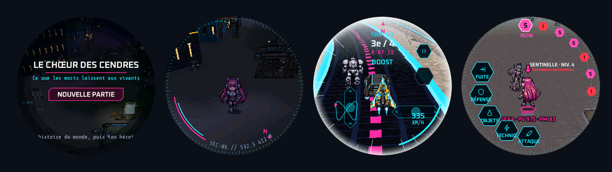</p>
<p align="center">
  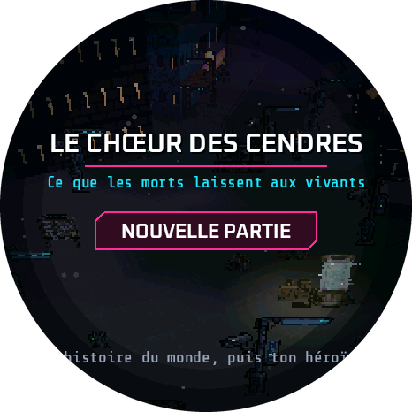
  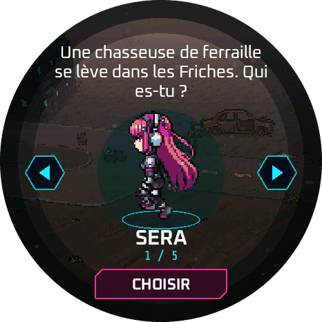
  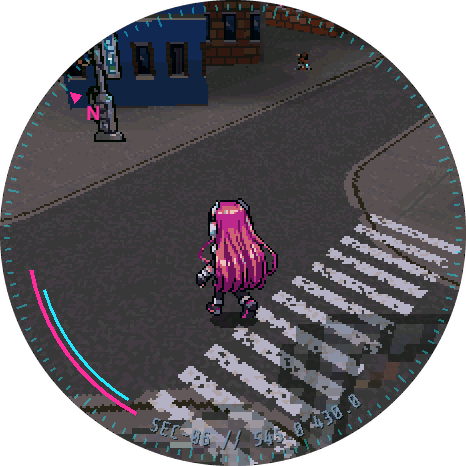
  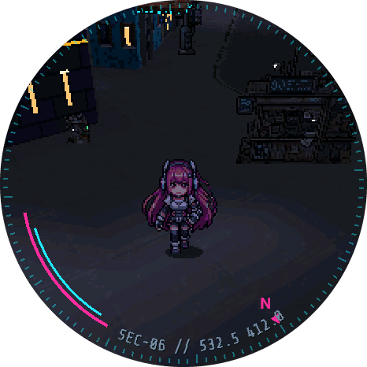
</p>
<p align="center">
  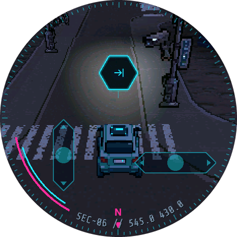
  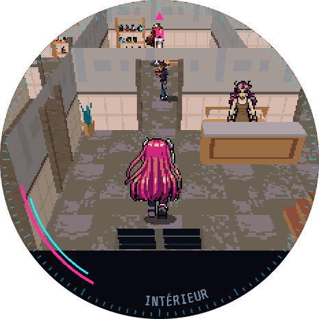
  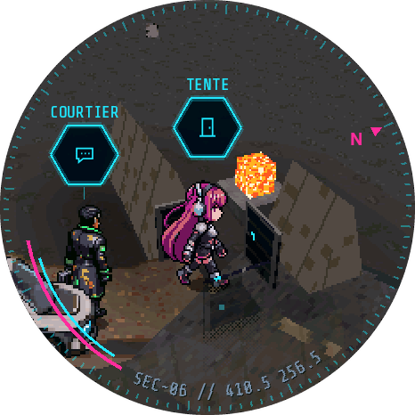
  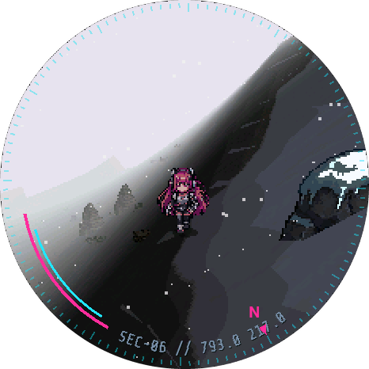
</p>
<p align="center">
  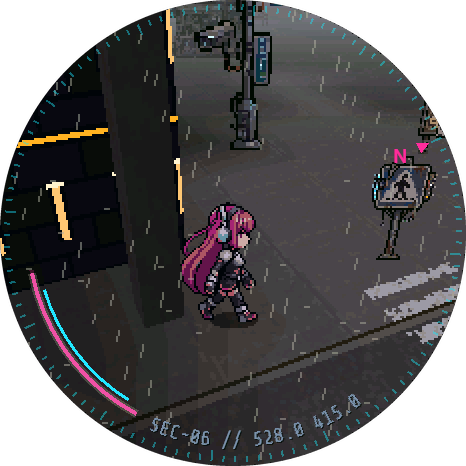
  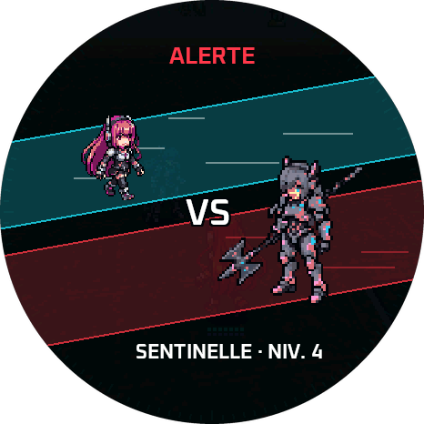
  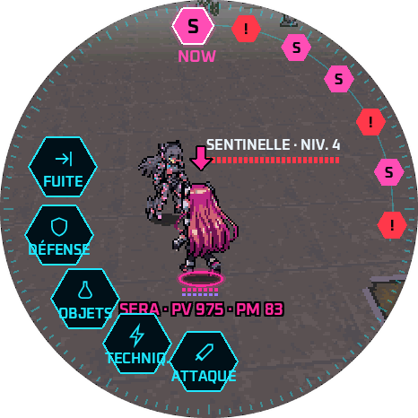
  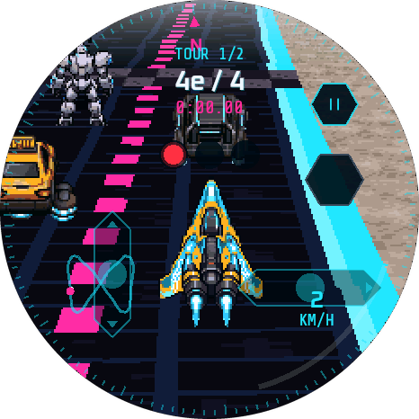
</p>
<p align="center">
  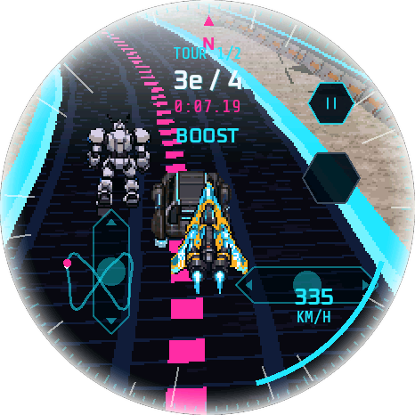
  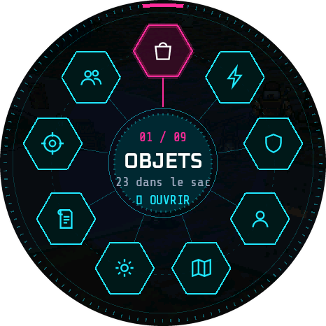
  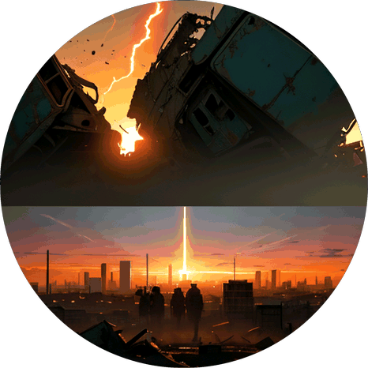
</p>

## Contents

| Folder | What |
|---|---|
| `engine/core` | the engine, without platform dependencies: world streaming, renderer (software, by bands), battles, story scripts, races, audio mixer, round UI |
| `engine/platform/esp32` | ESP-IDF 5.2.3 firmware for the watch (CO5300 display by bands, touch, SD card, ES8311 audio, Poké Ball Plus controller over BLE) |
| `engine/platform/web` | WebAssembly page |
| `engine/platform/android` | NativeActivity app (watch and phone), no Java besides a settings screen |
| `engine/tools` | build scripts (web, Android), world packaging, SD transfer, test renderer (`rendu_test.c`), balancing simulator |
| `engine/maquettes` | UI mock-ups |
| `engine/data/enfant` | the game world, safe edition (Git LFS) |
| `engine/data/musique.bin` | music (Git LFS) |
| `montre/` | the watch's home firmware (watch face, notifications, app launcher) |
| `commun/` | UI code shared by the watch firmwares |

The world itself (terrain, buildings, characters, story) is produced by a separate content tool that is not part of
this repository; `engine/data` only holds its output.

## Getting the data

The world files are stored with Git LFS (the world is 169 MB):

```
git lfs install
git clone https://github.com/Nerobeus/echoes-of-ashes.git
```

## Building

All builds use the safe edition through their `--enfant` / `_enfant` variants:

- **Web**: `node engine/tools/build_web.js --enfant` (C compiled with Zig: `python -m ziglang cc`) gives
  `engine/build/moteur_enfant.html`.
- **Watch**: ESP-IDF 5.2.3, `engine/platform/esp32/idf_enfant.cmd build`; the world goes on the SD card
  (`/sd/echoes_enfant/`), the light package (`monde_esp32.pak`) in flash. The watch uses a partition table shared with
  other apps (`montre/partitions.csv`) and is flashed with `montre/flasher.py`.
- **Android**: `node engine/tools/build_android.js --enfant` (Android NDK, no Gradle).

## Licence

© 2026 Nerobeus. All rights reserved: the code and the game content are published for reading and personal play;
no licence to reuse, modify or redistribute them is granted. Third-party assets inside the world and the music keep
their own licences, listed in [THIRD_PARTY.md](THIRD_PARTY.md).

Related: [pokeball-plus-re](https://github.com/Nerobeus/pokeball-plus-re), how the Poké Ball Plus is used as the
watch's controller.
